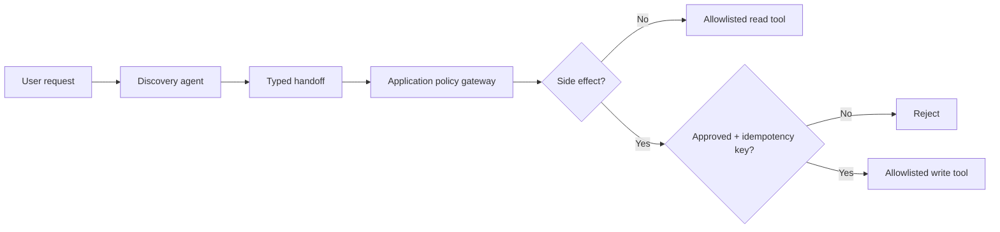

# Agentic Reliability Patterns

**Trust boundaries, structured handoffs, side-effect approvals, and idempotency—shown in executable Python.**

[](https://github.com/kbsai777/agentic-reliability-patterns/actions/workflows/tests.yml)


LLMs can propose actions; application code must decide which actions are allowed. This repository demonstrates that separation in a dependency-free, **local-only meeting-room reservation simulation**. It makes no external bookings, uses no paid API, and contains no proprietary code.

## Quick start

```bash
git clone https://github.com/kbsai777/agentic-reliability-patterns.git
cd agentic-reliability-patterns
python -m reliable_agents.demo
python -m unittest discover -s tests -v
```

## What's implemented

| Pattern | Where | Why it matters |
| --- | --- | --- |
| Trusted identity context | `contracts.py` | Caller identity is injected by application code, never trusted from model arguments |
| Structured agent handoff | `Handoff` | Preserves selected entity, intent, and traceable task identifier |
| Tool allowlist | `ToolGateway` | Unregistered tool calls are rejected |
| Explicit approval | `ToolGateway.execute` | Side effects require approval from a trusted caller |
| Idempotency | `ToolGateway.execute` | Repeated approved requests return the stored result |
| Tenant isolation | `RoomService` | Example state keys include tenant identity |
| Automated tests | `tests/` | Twelve unit tests cover normal and adversarial paths |

## Execution flow



## What this is NOT

It is a **reference pattern**, not a production booking API or complete authorization solution. The idempotency store is in-memory; durable multi-process deployments require a shared transactional store, concurrent-write protection, request-level authentication, real entitlement checks, and observability. Do not use the `approved` parameter as a substitute for verified human consent in a real application.

## Project layout

```text
reliable_agents/
  contracts.py       # Typed identity and handoff contracts
  gateway.py         # Tool boundary and replay protection
  demo.py            # Fully local end-to-end example
tests/
  test_gateway.py
```

## More patterns to add

- Bounded retries and circuit breakers for read-only tools
- Persisted idempotency ledger and concurrency tests
- OpenTelemetry-style tracing adapters
- Model-facing schema validators and prompt-injection regression fixtures

Contributions are welcome. See [CONTRIBUTING.md](CONTRIBUTING.md) and [SECURITY.md](SECURITY.md).
